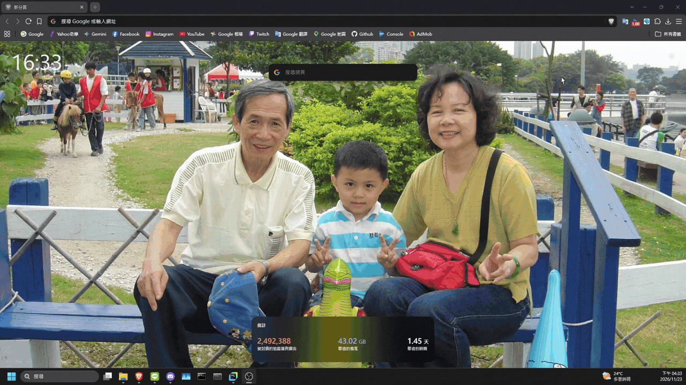

# LinkedIn Games Solver

A Chrome extension that automatically solves LinkedIn's daily games in one click.

> Forked and enhanced from [ronnielgandhe/linkedin-games-solver](https://github.com/ronnielgandhe/linkedin-games-solver).

  

## ✨ What's New & Improved

- Fixed board detection issues in certain games
- Added **Solve All** one-tap mode
- Added 2-second timing check to prevent score-saving errors
- Redesigned popup UI with a daily reset countdown and debug panel
- Added **Sumbreak** support in v2.0

## 🎮 Supported Games

- ✅ Mini Sudoku
- ✅ Tango
- ✅ Queens
- ✅ Zip
- ✅ Patches
- ✅ Sumbreak

## 🚀 Installation

1. Log in to [LinkedIn](https://www.linkedin.com/games/) in your Chromium-based browser (Chrome, Edge, Brave, etc.).
2. Download this repository as a `.zip` file (click **Code** → **Download ZIP**) and extract it.
3. Open your browser's extensions page (`chrome://extensions/`).
4. Enable **Developer mode** in the top-right corner.
5. Click **Load unpacked** and select the extracted folder.
6. Click the extension icon in your toolbar and pick a game, or hit **Solve All Games in one tap!**

## ⚠️ Disclaimer

This project is intended for educational and personal experimentation purposes only.     
Automating interactions on LinkedIn may violate their Terms of Service.     
Use responsibly and at your own discretion.

## 🙏 Credits

Original concept and base extension by [@ronnielgandhe](https://github.com/ronnielgandhe/linkedin-games-solver).

---

⭐ If you find this extension helpful, please consider giving this repository a star!
